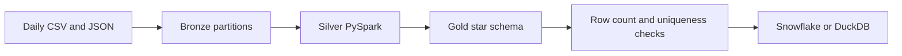

# CloudStream ETL

CloudStream loads a daily retail extract into a small lakehouse. Each day arrives as an orders CSV plus newline-delimited JSON for customers and products. The job lands those files as bronze partitions, cleans them with PySpark, builds a star schema, and merges that schema into Snowflake. The same merge runs locally against DuckDB when Snowflake credentials are not set.

## Features

- Bronze partitions for each ingest date, on local disk or in Amazon S3.
- Silver tables with a declared schema. Duplicate keys collapse to the latest `updated_at`. Rows that fail to parse, or that break a business rule, are written to quarantine instead of being dropped silently.
- A gold star schema: `fact_orders`, `dim_customers`, `dim_products`, and `dim_date`.
- Customer history is SCD Type 2. Product attributes are SCD Type 1. Facts keep one current row per order.
- Idempotent `MERGE` statements load the star schema. Re-running a partition does not insert a second copy, and an older file does not overwrite a newer change.
- An Airflow DAG runs the day end to end and checks row counts and uniqueness. Connection values come from the environment.

## Architecture



| Layer | What it holds |
| --- | --- |
| Bronze | The file as it arrived, under `bronze/<dataset>/ingest_date=YYYY-MM-DD/`. |
| Quarantine | Rejected rows and a `reject_reason`. |
| Silver | One clean row per business key for that day. |
| Gold | The current star schema. Customer history is kept here, not only the latest snapshot. |
| Warehouse | The same star schema, loaded with `MERGE`. |

`fact_orders` is one row per `order_id`. `dim_customers` is one row per version. `dim_products` is one row per product. `dim_date` is a calendar from 2024 through 2027. The fact stores the price charged on the order. The product dimension stores the current list price, which can move independently.

Airflow task order:

`land_bronze` → `bronze_to_silver` → `silver_to_gold` → `dq_row_counts` → `dq_uniqueness` → `load_snowflake`

The warehouse load runs the SQL checks again inside the same transaction. A failed check rolls the merge back.

## Layout

```text
dags/cloudstream_daily.py          Airflow DAG
sample_data/YYYY-MM-DD/            two example days
sql/duckdb/01_ddl.sql              local warehouse tables
sql/snowflake/                     Snowflake tables and temp staging
sql/merge/                         MERGE scripts used by both engines
src/cloudstream/landing.py         bronze copy or S3 upload
src/cloudstream/silver.py          schema, cleaning, dedupe, quarantine
src/cloudstream/gold.py            star schema, including SCD2 customers
src/cloudstream/quality.py         lake row-count and uniqueness checks
src/cloudstream/warehouse/         DuckDB loader and Snowflake loader
src/cloudstream/cli.py             local runner
```

## Run it locally

You need Python 3.11+ and a JDK. PySpark 3.5 is what this project is tested with. Java 17 and 21 both work.

```bash
python -m venv .venv
source .venv/bin/activate
pip install -r requirements.txt -r requirements-dev.txt
export JAVA_HOME=/usr/lib/jvm/java-21-openjdk-amd64   # adjust for the machine
cp .env.example .env
```

`.env` is not committed. The defaults use a local lake and DuckDB, so the sample days run with nothing filled in:

```bash
python -m cloudstream.cli run --date 2026-03-01
python -m cloudstream.cli run --date 2026-03-02
```

The first day has a duplicate order, a negative quantity, a non-numeric quantity, a duplicate customer, a blank customer id, and a bad email. Those bad rows land in `data/lake/quarantine/`. The second day moves Riya Shah from Austin to Denver, adds Mina Ortiz, cancels order A101, and changes the Trail Bottle list price.

Inspect the warehouse:

```bash
python - <<'PY'
import duckdb
con = duckdb.connect("data/warehouse/cloudstream.duckdb")
print(con.execute("""
    select customer_id, city, effective_from, effective_to, is_current
    from dim_customers
    order by customer_id, effective_from
""").fetchall())
PY
```

Other commands are `land`, `silver`, `gold`, `load`, and `quality`. Each takes `--date`.

Load the sample days in order the first time. After that, running a date again is safe: keys are not duplicated, and a newer status or address is left in place.

## S3 and Snowflake

`STORAGE_BACKEND=s3` uploads the bronze files with boto3 and reads them through the `s3a` filesystem. Set `AWS_ENDPOINT_URL=http://localhost:4566` and the usual test keys (`test` / `test`) to point that at LocalStack. Leave the endpoint empty for real AWS and prefer a role over long-lived keys. The first Spark read of `s3a://` downloads the Hadoop AWS jars.

```bash
docker build -t cloudstream-etl .
docker run --rm -v cloudstream-data:/app/data cloudstream-etl run --date 2026-03-01
docker run --rm -v cloudstream-data:/app/data cloudstream-etl run --date 2026-03-02
```

The volume keeps the lake and the DuckDB file between the two days. Without it, March 2 has no record of customers that only appeared on March 1, and the uniqueness check rejects the fact.

`docker compose up --build` creates the bucket in LocalStack and runs March 1 with `STORAGE_BACKEND=s3`. The second day is:

```bash
docker compose run --rm pipeline run --date 2026-03-02
```

`WAREHOUSE_BACKEND=snowflake` uses the same merge files. The loader opens a connector session from `SNOWFLAKE_ACCOUNT`, `SNOWFLAKE_USER`, `SNOWFLAKE_PASSWORD`, `SNOWFLAKE_WAREHOUSE`, `SNOWFLAKE_DATABASE`, `SNOWFLAKE_SCHEMA`, and optional `SNOWFLAKE_ROLE`, stages each partition with `write_pandas`, then runs the `MERGE` scripts. Nothing in the repository has a real password.

## Airflow

Point Airflow at this repo and keep the environment variables in the deployment, not in the DAG.

```bash
export AIRFLOW_HOME=$PWD/.airflow
export PYTHONPATH=$PWD/src
export CLOUDSTREAM_HOME=$PWD
pip install "apache-airflow==2.10.4" --constraint \
  https://raw.githubusercontent.com/apache/airflow/constraints-2.10.4/constraints-3.11.txt
airflow db migrate
airflow dags test cloudstream_daily 2026-03-01
```

`airflow dags test` runs the tasks for that logical date in process. A normal scheduler reads `dags/`.

## Tests

```bash
pytest
ruff check src tests dags
```

`make test` and `make lint` call the same commands. The suite uses the sample days, checks that a replay does not change the star schema, and fails the quality checks on purpose when a fact is duplicated or missing. S3 landing is tested with moto. The Snowflake loader is exercised with a fake connection so the test does not need an account; the SQL it would send is the script under `sql/merge/` and `sql/snowflake/`.

## Design choices

**Schema enforcement.** CSV and JSON are read with a `StructType`, not inferred. A missing orders column fails the day. A bad value in one row is quarantined with a reason (`corrupt_record`, `missing_key`, `invalid_quantity`, `invalid_price`, `invalid_status`, `invalid_timestamp`, `invalid_email`) and the rest of the partition still loads.

**Latest update wins.** Silver keeps one row per key inside the file, ordered by `updated_at`. Gold facts and products then compare that row with what is already stored. A replay of an older partition loses to the newer `updated_at`, so cancelling A101 on March 2 is not undone by running March 1 again.

**Customer history.** A new attribute hash closes the open version (`is_current` false, `effective_to` set to the new `updated_at`) and inserts a new current row. The version key is a SHA-256 of the customer id, the effective timestamp, and the attribute hash. The warehouse insert uses that same key, so the lake and the warehouse describe the same versions. If the hash is unchanged, no new version is opened. If the file is older than the open version, it is ignored.

**Merge shape.** Dates insert when the surrogate is new. Products update in place when the staged hash differs and the extract is newer. Customers use two merges: one to close a changed current row, and one to insert a row that has no current version. Facts resolve `customer_sk` with a point-in-time join (`order_ts` falls inside `[effective_from, effective_to)`) and upsert on `order_id`. DuckDB is only a stand-in so the statements can be run without a Snowflake account. The Snowflake DDL is separate because the types differ (`TIMESTAMP_NTZ`, `NUMBER`).

**Checks.** Before the load, the lake must contain every silver key from the partition, fact and dimension keys must be unique, each customer must have one current row, and every fact key must resolve. The SQL script repeats the uniqueness checks and checks that every staged order and customer landed. The loader also compares lake and warehouse row counts for the four tables, including the count of current customers.

**Secrets.** `Settings.from_env()` reads `.env` and the process environment. The DAG calls that helper. boto3 uses its normal credential chain. The Spark S3A keys are copied from the environment only when `STORAGE_BACKEND=s3`.
